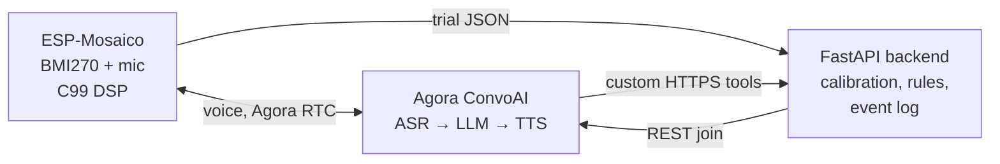

# NasoCheck: a pocket nasality meter with a voice coach

**Hold the board to the side of your nose and speak. It feels how much of your voice escapes through the nose, and an Agora voice agent runs a short, standard check in Bahasa Melayu or English and tells you whether you've changed since last time.**

Physical AI Hackathon Malaysia 2026 · Track: **Social Impact** (confirm at submission) · Team: @aarntn, @abqaryne, @mpip0505

> 🎥 **Demo video:** _link added after recording_ · 📊 **Live evidence page:** `GET /live` · 🧪 **Status:** software complete and tested on simulated data; hardware results below are filled in only from real trials.

---

## The problem
- **34.7%** of Malaysian school-age children with cleft lip/palate in one study still had hypernasal speech, and it correlated with speech distress ([Int J Pediatr Otorhinolaryngol, 2025](https://www.sciencedirect.com/science/article/abs/pii/S0165587625000692)).
- **156** public-sector speech-language therapists served Malaysia in 2023, about **1 per 209,615 people** ([CodeBlue](https://codeblue.galencentre.org/2023/06/zaliha-only-156-speech-language-therapists-in-moh/)).
- Nasality is mostly judged **by ear**, at appointments months apart. The objective instrument (the Nasometer) costs **thousands of US dollars** ([PMC4165226](https://pmc.ncbi.nlm.nih.gov/articles/PMC4165226/)).

Between visits, families practise with no objective feedback, and therapists can't see whether home practice is working.

## The solution in 30 seconds
1. **Hum "mmmm"** and the device calibrates (a fully nasal reference = 0 dB).
2. **Say "Papa pakai topi"** and the score stays low, because little sound goes through the nose.
3. **Say it through your nose** and the score jumps. The agent reads both scores and the difference.
4. Say the wrong phrase, move the device or speak too loudly, and the agent explains why the trial didn't count and asks again.

## How it works (the physics)
We use the **Horii Oral-Nasal Coupling index** ([Horii 1980](https://pubmed.ncbi.nlm.nih.gov/6930999/)). When the soft palate doesn't close, sound vibrates the nasal skin. The board's accelerometer feels that vibration, and its mic hears the voice. Dividing one by the other cancels loudness:

```
score_dB = 20·log10(accel_rms / mic_rms) − same ratio during a hum
```

In typically developing children this method separated nasal from oral speech by about **10–13 dB** (Varghese et al. 2014). Our go/no-go bar on this board is **6 dB**; see [FEASIBILITY.md](docs/FEASIBILITY.md) for the signal budget.

## Why Agora is essential, not decoration
The user's hands and eyes are busy holding a device to their face, so **the voice agent is the session operator**:

| Without Agora | With Agora |
|---|---|
| A bar on a tiny screen | A spoken, standard protocol in BM or English |
| Any utterance counts | ASR checks the right phrase was said; wrong phrase = retry |
| Bad trials silently skew results | Plain-language reasons: "too loud", "the device moved" |
| Numbers with no context | "12 dB higher than your normal version", compared with last session |

**The agent never invents a number.** Scores come from deterministic backend tools (`getNextStep`, `getLatestTrial`, `getSummary`) as ready-made sentences, and the system prompt forbids changing them. Details: [AGORA_INTEGRATION.md](docs/AGORA_INTEGRATION.md).

## Architecture

- **Device** (`firmware/nasocheck_dsp`): streaming C99. 80 Hz high-pass, 700 Hz low-pass, 40 ms frames, voiced-frame median ratio. No heap, ~4 KB state.
- **Backend** (`backend/`):
  - idempotent trial ingest
  - protocol state derived from an append-only event log, so a restart is safe
  - per-session HMAC tool tokens
  - USB serial and raw-upload fallbacks
- **Agent** (`agora/`): prompt plus three tools. Full design, reliability patterns and prior art: [ARCHITECTURE.md](docs/ARCHITECTURE.md).

## Evidence
| What | Result |
|---|---|
| Backend unit/API tests | **53 pass** (SIMULATED data) |
| C DSP vs Python reference | **3/3 vectors match within 0.001 dB** (compiled with `-Wall -Wextra -Werror`) |
| Go/no-go on hardware: /m/ vs /a/, 2 people, control | _Not run yet; [protocol](docs/NASOCHECK.md#10-gono-go-test-first-30-minutes)_ |
| End-to-end trials with live agent | _Not run yet_ |
| Latency, end of speech → spoken result | _Not measured yet (target 1.5–3 s)_ |

All results are logged in [TEST_RESULTS.md](docs/TEST_RESULTS.md). We only report numbers we measured.

## What already exists, and how we differ
| | Nasometer | mNasometer / Nosey | 2017 accelerometer game | **NasoCheck** |
|---|---|---|---|---|
| Cost | Thousands USD | Low | Few hundred USD | ~USD 59 dev board |
| Setup | Two mics + separation plate | Plate | Taped sensor | One handheld unit |
| Guided protocol and trial checking | Clinician | – | – | **Voice agent** |
| Malay coaching | – | – | – | **Yes** |

We claim a guided, single-device measurement session. We don't claim new physics, diagnosis or Nasometer equivalence.

## Run it
```sh
cd backend
pip install -r requirements.txt -r requirements-dev.txt
python -m pytest -q
cp ../.env.example .env        # set DEVICE_KEY, TOOL_SECRET, Agora keys
uvicorn nasocheck.app:app --port 8000
# no board? simulated end-to-end run:
python scripts/fake_device.py --lang ms --steps hum,oral:wrong,oral,nasal --agent
```
Open `http://localhost:8000/live` for the live score bar and trial table.

## Limitations (honest)
- **Not a diagnostic or clinically validated device.** It tracks change; the therapist decides.
- **Not a replication** of published work: our sensor is a whole board, the bandwidth is ~700 Hz and the mic is onboard.
- Phrase lists and coaching wording need review by a Malay-speaking speech therapist. There are no Malay norms on this device.
- Thresholds are initial guesses, tuned from go/no-go data and then frozen.

## Next steps
User interviews with therapists and parents ([plan](docs/USER_RESEARCH.md)). Then a pilot with a university speech clinic against a Nasometer, with ethics approval before any patient use.

---
<sub>Repo docs: [proposal](docs/NASOCHECK.md) · [feasibility](docs/FEASIBILITY.md) · [architecture](docs/ARCHITECTURE.md) · [Agora](docs/AGORA_INTEGRATION.md) · [demo script](docs/DEMO.md) · [tests](docs/TEST_RESULTS.md) · [rules](docs/RULES.md) · [rubric](docs/RUBRIC.md) · [workflow](docs/WORKFLOW.md) · [submission](docs/SUBMISSION.md). Never commit secrets or personal data; simulated data is always labelled.</sub>
