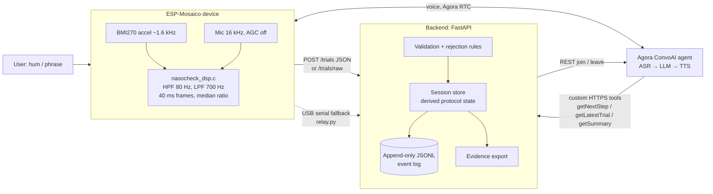
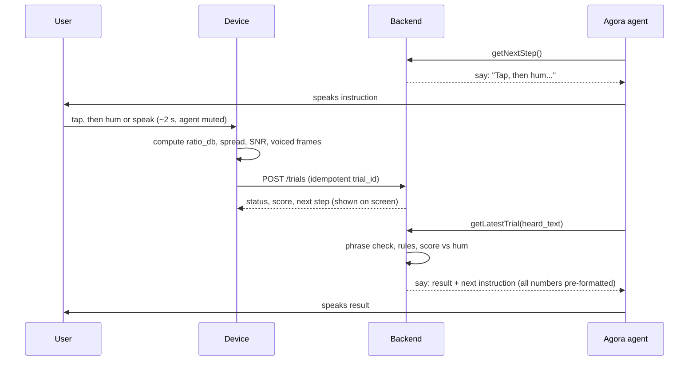

# System architecture: NasoCheck

Status: software implemented and tested on SIMULATED data (54 backend tests, C/Python parity). Hardware not yet tested. Update this page with what actually runs on the day.

## 1. Overview

## 2. Data flow for one trial

## 3. Responsibilities: deterministic vs AI
| Layer | Decides | Never decides |
|---|---|---|
| Device (C) | Signal features per trial | Scores, validity |
| Backend | Validity, calibration, score, phrase match, session comparison | Conversation wording beyond templates |
| LLM agent | Conversation flow, when to call tools, passing heard words | Any number, any validity judgement |

This split follows the proposal's rule that the agent "is never allowed to invent a number". The backend returns a ready sentence (`say`), and the system prompt forbids changing it.

## 4. Reliability design
| Concern | Mechanism | Precedent |
|---|---|---|
| Duplicate uploads on flaky Wi-Fi | `trial_id` is an idempotency key: the same id with the same body returns `duplicate: true`; a different body returns 409 | Idempotency keys in payment APIs (e.g. Stripe's `Idempotency-Key`) |
| Restart mid-demo | All state rebuilt from an append-only event log; protocol position is derived, not stored | Event sourcing (Fowler, 2005) |
| Agent asks before the trial arrives | Tool waits ≤2 s, then returns `pending` | HTTP long polling (RFC 6202) |
| Tool failure | Agora reports non-2xx to the model; the prompt says "technical problem, try again", never a guess | Agora custom-tools docs |
| No Wi-Fi | USB serial relay with retries | Proposal cut order |
| On-device DSP fails | Raw upload; backend runs the reference DSP | – |
| Port drift between C and Python | Shared vectors; CI checks parity | Golden-vector / test-vector practice in codec development |

## 5. Prior art: measurement science
NasoCheck uses an established method on unusual hardware. None of the work below was replicated here.

| System / study | Method | What we reuse | What differs |
|---|---|---|---|
| TONAR (Fletcher, 1970) and the Nasometer (nasalance = nasal/(nasal+oral) acoustic energy) | Two microphones separated by a plate | Oral-only test sentences (like the Zoo passage), ratio normalisation | We use skin vibration plus one mic, no plate |
| Lippmann (1981), "Detecting nasalization using a low-cost miniature accelerometer" | Low-cost accelerometer on the nose | Nasal skin vibration as a low-cost signal | Our sensor is inside the whole board |
| Nasal accelerometry vs nasalance (JSLHR 2013) | Nasal accelerometric amplitude vs Nasometer | Less affected by vowel than nasalance; comparable nasal/non-nasal discrimination, suggesting biofeedback use | Different sensor and bandwidth |
| Nasal accelerometer and nasal air emission (JSLHR 2016) | Correlated with nasal airflow r = .87, with perceptual ratings only r = .49 | **Why we track change and never diagnose:** a physical measure is not a listener's judgement | – |
| Horii (1980), HONC index | Accelerometer/mic ratio, calibrated on a nasal consonant | Exact score formula and hum calibration (proposal §3) | Our bandwidth is limited (~700 Hz) |
| Varghese et al. (2014) | HONC in children: 10–13 dB separation, moderate test-retest | Rejection rules, median over frames, **≥2 trials before comparing sessions**, a 3 dB "about the same" band (assumption) | Disordered speakers not studied |
| 2017 accelerometer biofeedback game | Home practice with live feedback | Home-practice use case | We add a spoken protocol and trial checking |
| mNasometer (2026), Nosey (2025) | Low-cost acoustic nasometers | Low-cost goal | They need a separation plate |

Citations and links are in [NASOCHECK.md](NASOCHECK.md) §2–4. Verified by web search on 28 Nov 2026: Lippmann 1981; JSLHR 2013 ([doi 10.1044/1092-4388(2013/12-0239)](https://pubs.asha.org/doi/10.1044/1092-4388(2013/12-0239))); JSLHR 2016 ([doi 10.1044/2016_JSLHR-S-15-0407](https://pubs.asha.org/doi/10.1044/2016_JSLHR-S-15-0407)); Nosey and mNasometer ([UWO 2026 PDF](https://www.uwo.ca/fhs/csd/smdl/research/publications/Development-and-evaluation-of-a-low-cost-open-source-nasometer-May-8-2026-final-version.pdf), [Sensors 2026](https://www.mdpi.com/1424-8220/26/9/2739)). TONAR (Fletcher 1970) is still unverified; don't use it on slides.

## 6. Limitations (say these out loud)
- **Not a replication.** The sensor is heavy, the bandwidth limited and the mic onboard.
- **Not validated:** no comparison with a Nasometer or with clinician ratings, and no Malay norms.
- **Draft settings:** thresholds are initial guesses, set by environment variable and frozen after go/no-go. The phrase lists are drafts pending review by a speech therapist.
- **Not a diagnostic device.** It tracks change over time.
