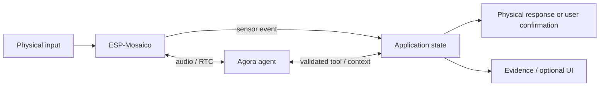

# Architecture overview — draft, no implementation

Proposed interfaces only; verify actual transport and device APIs before choosing. At kickoff record firmware revision, stack, deployment, data flows and failure paths. Separate deterministic sensor readings and state from AI interpretation. Minimal shared event fields: event_id, session_id, source, type, timestamp, payload; units explicit. Agent action returns status and reason; retry idempotently. Never expose credentials or real personal data. Replace diagram with actual implementation before submission.
